<div align="center">

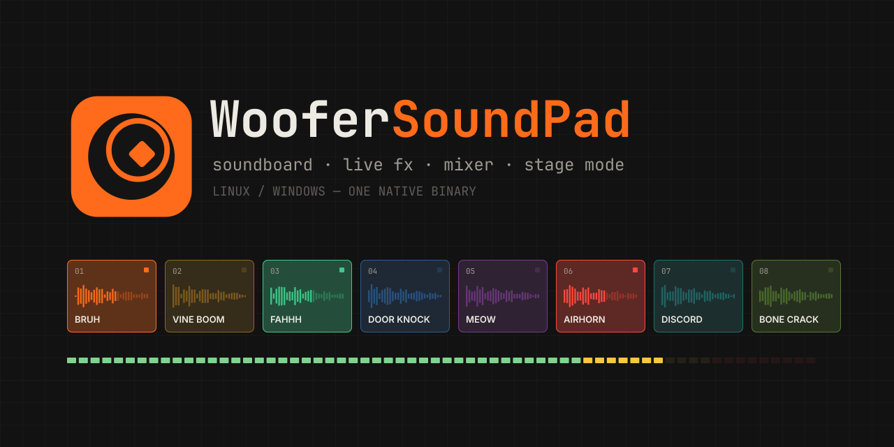

<br>

[](https://github.com/RshaCuDeVidro/WooferSoundPad/actions/workflows/ci.yml)
[](https://github.com/RshaCuDeVidro/WooferSoundPad/releases/latest)
[](https://github.com/RshaCuDeVidro/WooferSoundPad/releases)
[](#download)
[](https://ziglang.org)
[](LICENSE)

### Um soundboard feito como instrumento.

Dispare sons no Discord, nos jogos e nas lives com atalhos. Deforme tudo ao vivo com uma cadeia de efeitos,<br>
controle os níveis num mixer, vá pra tela cheia no Stage Mode, grave qualquer coisa que o PC tocar.<br>
Um executável nativo. Sem Electron, sem conta, sem chave de API.

**[Download](https://github.com/RshaCuDeVidro/WooferSoundPad/releases/latest)** &nbsp;·&nbsp;
**[Tutorial](docs/TUTORIAL.pt-BR.md)** &nbsp;·&nbsp;
**[English](README.md)** &nbsp;·&nbsp;
**[OBS e Stream Deck](#obs-e-stream-deck)**

<br>

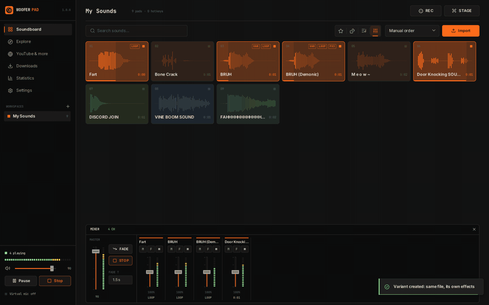

</div>

<br>

## O que tem dentro

<table>
<tr>
<td width="33%" valign="top">

**TOCAR**

Pads com forma de onda, LED de status e atalho grande na tela. Modos reiniciar, sobrepor ou alternar. Fila com arrastar pra reordenar, embaralhar e repetir. Atalhos globais enquanto você joga. Teclas 0–9.

</td>
<td width="33%" valign="top">

**MOLDAR**

Doze efeitos ao vivo que você encadeia e reordena: tom, filtros, rádio, distorção, bitcrusher, eco, reverb, chorus, tremolo, robô, ganho. Automatize qualquer parâmetro ao longo do som. Salve presets. Faça variantes do mesmo arquivo.

</td>
<td width="33%" valign="top">

**SE APRESENTAR**

Um mixer com um canal por som: medidor, fader, mudo, fade-out. Stage Mode: tela cheia, pads gigantes, botão de pânico. Uma botoneira web pro celular e um overlay pro OBS.

</td>
</tr>
<tr>
<td valign="top">

**EDITAR**

Editor com forma de onda e zoom: arraste pra selecionar, clique pra ouvir, alças de fade na própria onda, início e fim exatos com ajuste de 10 ms, corte automático de silêncio, prévia em loop, desfazer e refazer. Nada mexe no arquivo até você mandar.

</td>
<td valign="top">

**JUNTAR**

Navegue pelo MyInstants e SoundButtonsWorld dentro do app. Busque no YouTube e no SoundCloud ou cole link de mais de 1000 sites (yt-dlp, sem chave). Grave o que o PC está tocando. Arraste e solte arquivos.

</td>
<td valign="top">

**GUARDAR**

Workspaces são pastas comuns. Normalização de volume da biblioteca inteira, que liga e desliga. Estatísticas: plays, tempo tocado, ranking dos memes, gráfico de 14 dias e histórico. Modo portátil pra pendrive.

</td>
</tr>
</table>

<br>

## Prints

<table>
<tr>
<td colspan="2">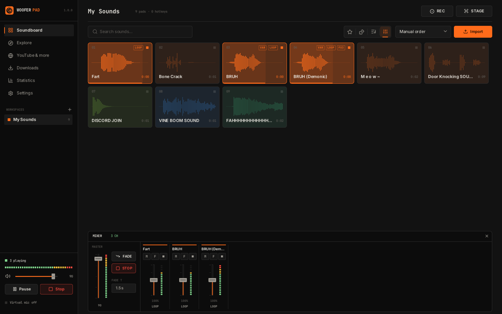<br><sub><b>Soundboard + mixer.</b> As etiquetas de cada pad dizem o que muda o som: FX, LOOP, CUT, VAR (variante), posição na fila.</sub></td>
</tr>
<tr>
<td width="50%">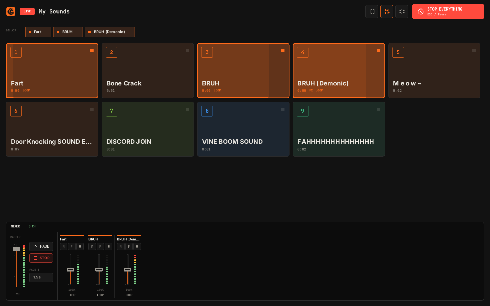<br><sub><b>Stage Mode.</b> Tela cheia, atalhos legíveis do outro lado do quarto, faixa ON AIR, botão de pânico.</sub></td>
<td width="50%">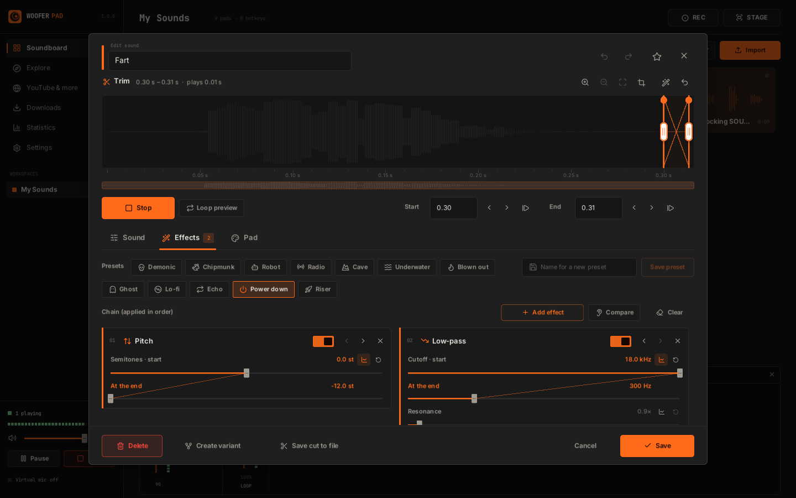<br><sub><b>Cadeia de efeitos.</b> O preset "Desligando": tom e passa-baixa deslizam até o valor final.</sub></td>
</tr>
<tr>
<td>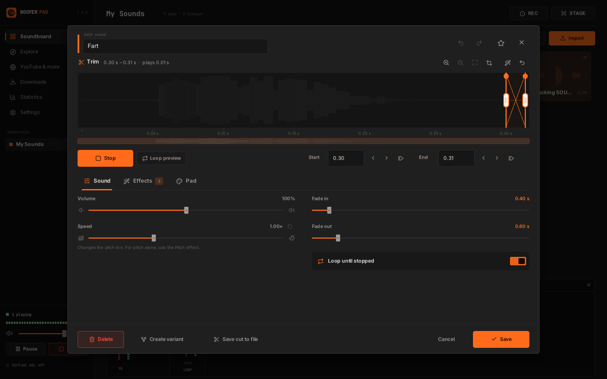<br><sub><b>Editor.</b> Forma de onda com zoom, alças de fade, corte exato, desfazer.</sub></td>
<td>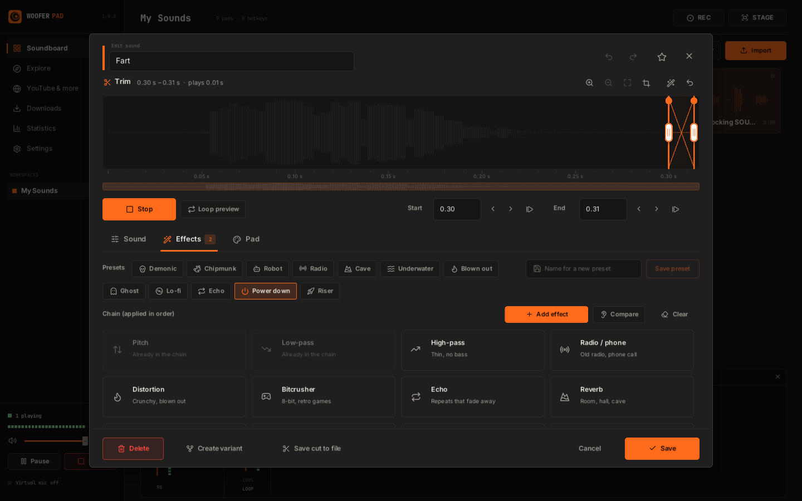<br><sub><b>Doze efeitos</b>, cada um no máximo uma vez por cadeia.</sub></td>
</tr>
<tr>
<td>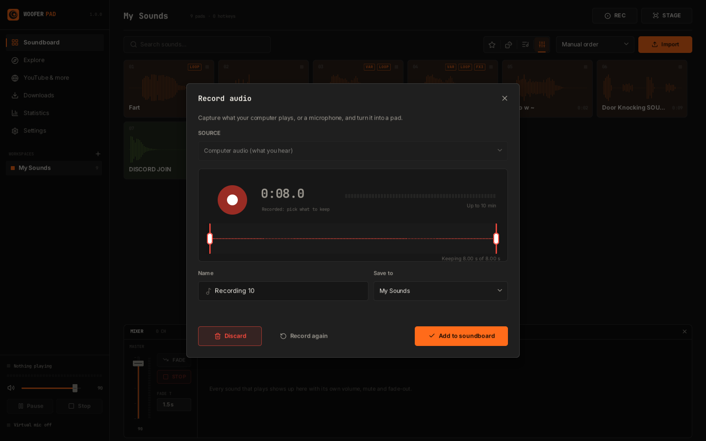<br><sub><b>Gravador.</b> Captura o som do PC ou um microfone, corta o silêncio, fica com o que importa.</sub></td>
<td>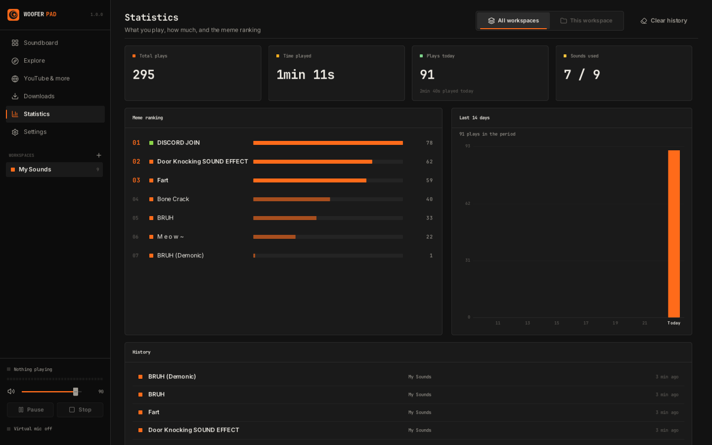<br><sub><b>Estatísticas.</b> Plays, tempo tocado, ranking, últimos 14 dias, histórico.</sub></td>
</tr>
<tr>
<td>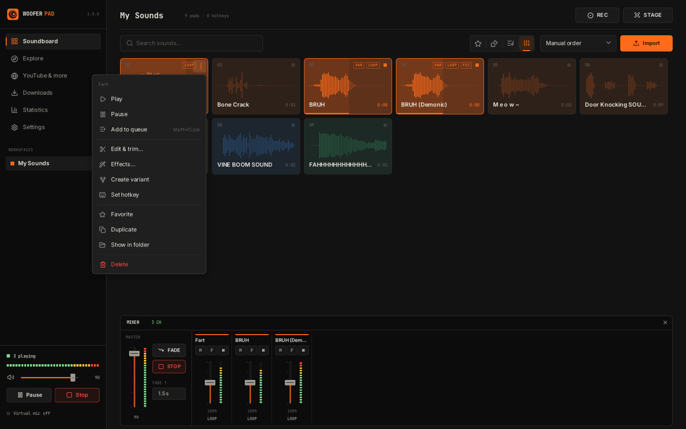<br><sub><b>Menu do pad.</b> Editar e cortar, efeitos, variantes, atalho, mover entre workspaces.</sub></td>
<td>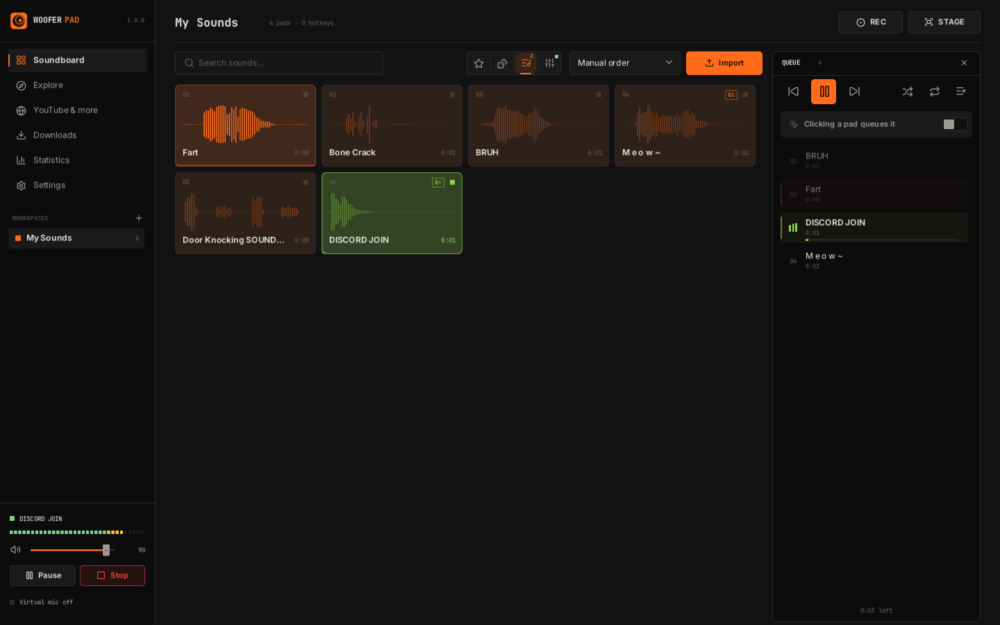<br><sub><b>Fila.</b> Shift+clique nos pads pra enfileirar.</sub></td>
</tr>
<tr>
<td>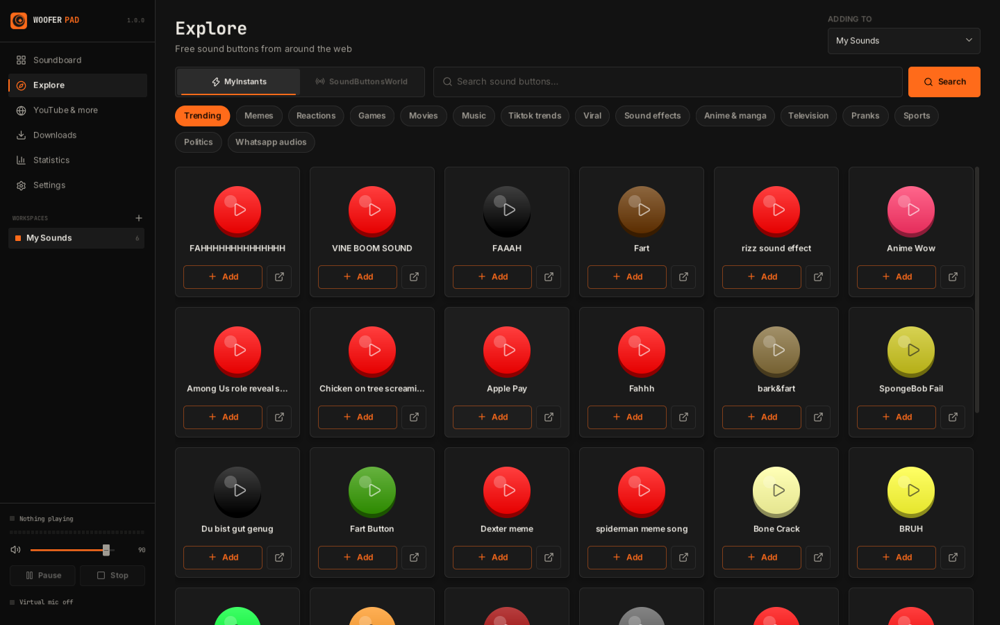<br><sub><b>Explorar.</b> MyInstants e SoundButtonsWorld: prévia, adicionar com um clique.</sub></td>
<td>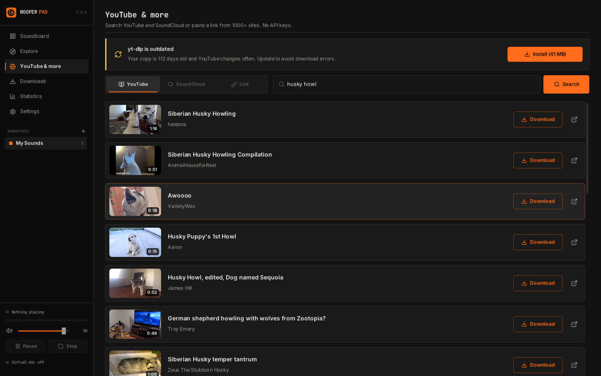<br><sub><b>YouTube e mais.</b> Busca com miniaturas, ou cole um link.</sub></td>
</tr>
<tr>
<td>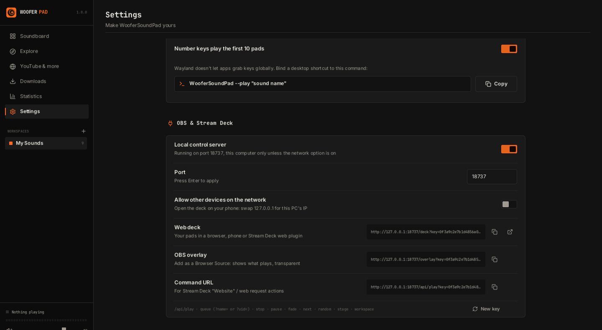<br><sub><b>OBS e Stream Deck.</b> Uma chave, links prontos pra copiar.</sub></td>
<td>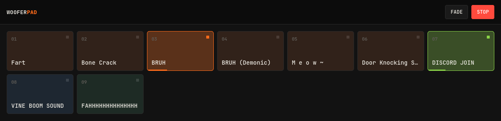<br><sub><b>Botoneira web.</b> Seus pads em qualquer navegador, inclusive no celular.</sub></td>
</tr>
<tr>
<td>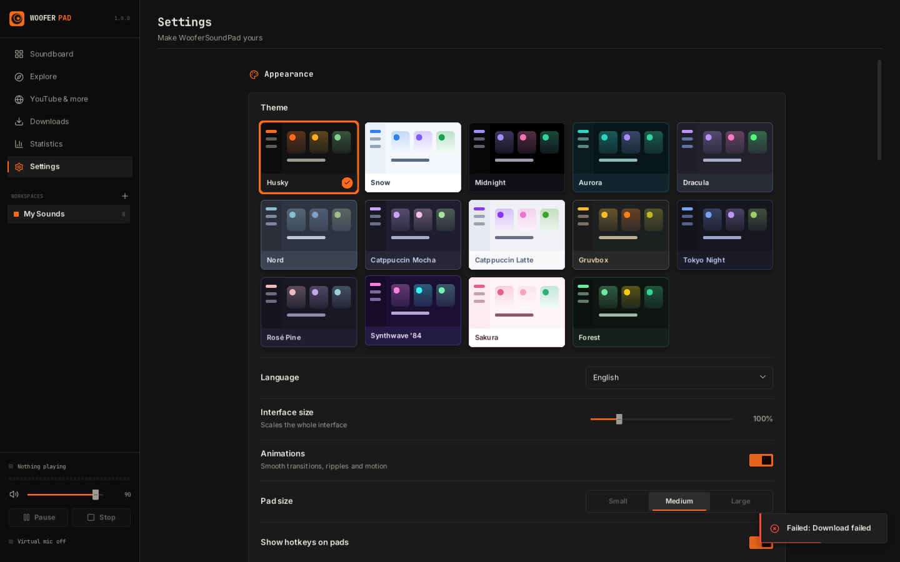<br><sub><b>14 temas</b> com prévia ao vivo.</sub></td>
<td>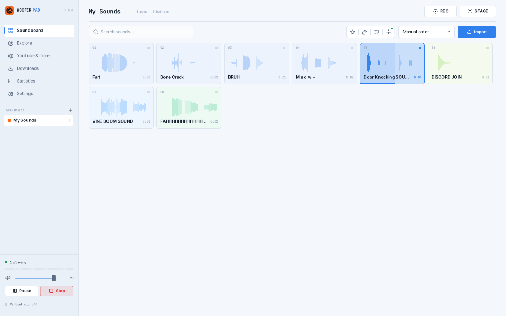<br><sub><b>Snow</b>, um dos claros.</sub></td>
</tr>
</table>

<br>

## Conteúdo

- [Download](#download)
- [Começo rápido](#começo-rápido)
- [Teclado e mouse](#teclado-e-mouse)
- [Efeitos, automação e presets](#efeitos-automação-e-presets)
- [O editor](#o-editor)
- [Mixer e Stage Mode](#mixer-e-stage-mode)
- [Gravando o som do PC](#gravando-o-som-do-pc)
- [Normalização de volume](#normalização-de-volume)
- [Estatísticas](#estatísticas)
- [OBS e Stream Deck](#obs-e-stream-deck)
- [Microfone virtual (Discord, jogos, calls)](#microfone-virtual-discord-jogos-calls)
- [Atalhos globais](#atalhos-globais)
- [Linha de comando](#linha-de-comando)
- [Modo portátil e onde ficam seus dados](#modo-portátil-e-onde-ficam-seus-dados)
- [Compilando](#compilando)
- [Estrutura do projeto](#estrutura-do-projeto)
- [Perguntas frequentes](#perguntas-frequentes)
- [Créditos e licença](#créditos-e-licença)

<br>

## Download

Cada versão na **[página de Releases](https://github.com/RshaCuDeVidro/WooferSoundPad/releases/latest)** vem em alguns sabores. Todos são o mesmo app.

| Arquivo | O que é |
|---|---|
| `WooferSoundPad-<versão>-windows-x86_64.exe` | **Windows.** O app em si: um arquivo, dois cliques e pronto. |
| `WooferSoundPad-<versão>-windows-x86_64-portable.zip` | **Windows, portátil.** Extraia onde quiser (até num pendrive): configurações, ferramentas e sons ficam na pasta. |
| `WooferSoundPad-<versão>-windows-x86_64-compact.zip` | **Windows, compacto.** Só o `.exe`, comprimido pra menos da metade do tamanho, pra internet lenta. |
| `WooferSoundPad-<versão>-linux-x86_64` | **Linux.** O app em si: `chmod +x` e rode. |
| `WooferSoundPad-<versão>-linux-x86_64-compact` | **Linux, compacto.** O mesmo binário comprimido com UPX, cerca de um terço do tamanho; descomprime na memória ao abrir. |
| `WooferSoundPad-<versão>-linux-x86_64.tar.gz` | **Linux, com instalador.** Põe no menu de apps com ícone: `./install.sh`. |
| `SHA256SUMS.txt` | Checksums: `sha256sum -c SHA256SUMS.txt --ignore-missing` |

<details>
<summary><b>Requisitos</b></summary>

<br>

**Linux** (x86_64)

- Desktop X11 ou Wayland (no Wayland roda via XWayland) com OpenGL 3.3.
- `curl` pras requisições web (já vem em quase tudo).
- `pactl` pro microfone virtual de um clique e pra gravar o som do PC (`pipewire-pulse` ou `pulseaudio-utils`).
- `zenity` ou `kdialog` pros seletores de arquivo de Importar e Procurar.

**Windows** 10 (1803 ou mais novo) ou 11, x86_64

- Nada pra instalar. [VB-Cable](https://vb-audio.com/Cable/) (grátis) se quiser tocar no chat de voz.

</details>

<details>
<summary><b>Instalador do Linux</b></summary>

<br>

```sh
tar -xzf WooferSoundPad-*-linux-x86_64.tar.gz
cd WooferSoundPad
./install.sh              # ~/.local/bin, entrada no menu e ícone
./install.sh --uninstall  # remove de novo; seus sons e configurações ficam
```

Não precisa de root. `sudo PREFIX=/usr/local ./install.sh` instala pro sistema todo.

</details>

<br>

## Começo rápido

> A versão passo a passo, com calma, é o **[tutorial](docs/TUTORIAL.pt-BR.md)**.

1. **Abra.** Um tour de 30 segundos aparece na primeira vez (F1 abre de novo).
2. **Adicione sons.** Arraste arquivos pra janela, aperte Ctrl+O, pegue no **Explorar**, baixe no **YouTube e mais**, ou aperte **REC** pra gravar o que o PC está tocando.
3. **Toque.** Clique num pad, aperte 1–9 / 0, ou dê um atalho (botão direito → Definir atalho). Espaço pausa tudo, Esc para tudo.
4. **Molde.** Botão direito → Efeitos. Escolha um preset como Demoníaco, Robô ou Desligando, ou monte uma cadeia. Botão direito → Criar variante pra guardar a versão limpa também.
5. **Vá ao vivo.** Configurações → Microfone virtual pra tocar no Discord. Abra o **mixer** pela barra de ferramentas, ou aperte **F11** pro Stage Mode.

<br>

## Teclado e mouse

| Tecla | Ação |
|---|---|
| <kbd>1</kbd> … <kbd>9</kbd>, <kbd>0</kbd> | Toca os dez primeiros pads (dá pra desligar nas Configurações) |
| <kbd>Espaço</kbd> | Pausa tudo / continua. No editor: toca ou para a prévia |
| <kbd>Esc</kbd> | Para tudo (e a fila) |
| <kbd>F11</kbd> | Liga / desliga o Stage Mode |
| <kbd>Pause</kbd> | Parar tudo global (troque em Configurações → Atalhos) |
| <kbd>Shift</kbd> + clique num pad | Põe na fila |
| Botão direito num pad | Tocar, pausar, fila, editar e cortar, efeitos, criar variante, atalho, favorito, duplicar, mostrar na pasta, mover, excluir |
| Botão direito num pad no Stage Mode | Para só aquele som |
| <kbd>Ctrl</kbd>+<kbd>1</kbd> … <kbd>6</kbd> | Soundboard, Explorar, YouTube e mais, Downloads, Estatísticas, Configurações |
| <kbd>Ctrl</kbd>+<kbd>F</kbd> / <kbd>Ctrl</kbd>+<kbd>O</kbd> | Buscar sons / importar arquivos |
| <kbd>Ctrl</kbd>+<kbd>Z</kbd>, <kbd>Ctrl</kbd>+<kbd>Shift</kbd>+<kbd>Z</kbd> ou <kbd>Ctrl</kbd>+<kbd>Y</kbd> | Desfazer / refazer no editor |
| Roda do mouse na forma de onda | Zoom (com <kbd>Shift</kbd>: rola pro lado) |
| <kbd>F1</kbd> | O tour |

<br>

## Efeitos, automação e presets

Cada pad tem uma **cadeia de efeitos** de até oito efeitos, aplicados ao vivo, em ordem, enquanto ele toca. Mudou um valor, você ouve na hora, mesmo num som que já está tocando. O arquivo no disco nunca muda.

| Efeito | Parâmetros | Bom pra |
|---|---|---|
| Tom | semitons (−12 … +12) | Mais agudo ou grave sem mudar a velocidade |
| Passa-baixa | corte, ressonância | Abafado, atrás da parede, debaixo d'água |
| Passa-alta | corte, ressonância | Fino, sem grave |
| Rádio / telefone | centro, largura | Rádio velho, ligação |
| Distorção | intensidade, mistura | Rasgado, estourado |
| Bitcrusher | bits, retenção, mistura | 8-bit, jogo retrô |
| Eco | tempo, repetição, mistura | Repetições que somem |
| Reverb | tamanho, abafamento, mistura | Sala, salão, caverna |
| Chorus | velocidade, profundidade, mistura | Largo, ondulado |
| Tremolo | velocidade, profundidade | Volume pulsando |
| Robô | frequência, mistura | Voz metálica |
| Ganho | dB (−24 … +24) | Mais alto ou mais baixo |

**Automação.** Clique no botãozinho de gráfico ao lado de qualquer parâmetro e ele ganha um segundo valor, *No fim*. O parâmetro desliza do primeiro pro segundo ao longo do som (e recomeça quando repete). Tom de 0 até −12 com um passa-baixa fechando é o clássico "desligando"; o contrário é o "subindo".

**Presets.** Doze vêm prontos: Demoníaco, Esquilo, Robô, Rádio, Caverna, Debaixo d'água, Estourado, Fantasma, Lo-fi, Eco, Desligando e Subindo. Montou uma cadeia que curtiu? Dê um nome e **Salvar**: seus presets aparecem do lado dos prontos em qualquer pad.

**Variantes.** Uma variante é um segundo pad que toca o **mesmo arquivo** com nome, corte, ajustes e efeitos próprios: "BRUH" e "BRUH (Demoníaco)" sem duplicar o áudio. Botão direito → **Criar variante**, ou o botão no editor. Variantes ganham a etiqueta **VAR**; apagar ou mover uma nunca quebra as outras.

**Comparar.** A chave *Comparar* desliga a cadeia enquanto você escuta, pra comparar o efeito com o som limpo.

<br>

## O editor

Botão direito num pad → **Editar e cortar** (ou Efeitos).

- **Forma de onda.** Arraste em cima dela pra escolher o que toca; arraste as alças brancas pra ajustar; clique em qualquer ponto pra tocar dali. As alças redondas no topo definem o fade-in e o fade-out direto na onda.
- **Zoom.** Roda do mouse, os botões, *zoom no corte*, ou arraste a faixa embaixo da régua pra rolar.
- **Corte exato.** Digite início e fim, ajuste de 10 em 10 ms (100 ms com Shift), ou marque na posição que está tocando.
- **Corte automático** tira o silêncio do começo e do fim. **Repetir prévia** deixa o corte tocando enquanto você mexe.
- **Aba Som:** volume, velocidade (0,5× a 2×, muda o tom junto), fades, repetir. **Aba Efeitos:** a cadeia. **Aba Pad:** cor, atalho, e o que o app sabe do som (plays, tempo tocado, volume medido).
- **Desfazer / refazer** cada passo: Ctrl+Z, Ctrl+Shift+Z, ou as setas no cabeçalho.
- **Gravar no arquivo** grava o corte no áudio de vez (precisa do ffmpeg). Se outras variantes usam o arquivo, esse pad ganha um arquivo só dele e elas ficam com o original.

<br>

## Mixer e Stage Mode

**O mixer** fica encaixado embaixo do soundboard (botão na barra de ferramentas, ou na barra do Stage Mode). O canal master tem o fader geral, *FADE* (abaixa tudo até parar) e *STOP*, mais a duração do fade. Depois, cada som tocando ganha um canal:

| Controle | O que faz |
|---|---|
| Medidor | Nível de saída depois dos efeitos, estilo LED |
| Fader | Volume só deste play, 0–200%, com marca nos 100% |
| M | Muta este som |
| F | Fade-out na duração escolhida |
| ■ | Para na hora |

Mudanças no mixer valem só pro play atual; o volume do pad fica no editor.

**Stage Mode** (F11, ou **STAGE** no cabeçalho) é o soundboard pra quando você está ao vivo: tela cheia, pads gigantes com os atalhos, uma faixa *ON AIR* com o que está tocando (clique num pra parar), o mixer embaixo e um botão enorme de **PARAR TUDO**. Esc continua parando tudo, os números continuam tocando. Em Configurações → Aparência você escolhe se ele vai pra tela cheia.

<br>

## Gravando o som do PC

Clique em **REC** no cabeçalho do soundboard.

1. Escolha a **fonte**: *Áudio do PC (o que você ouve)*, o microfone padrão, ou qualquer dispositivo de entrada.
2. Aperte o botão vermelho, toque o que quer pegar, aperte de novo. Você vê a forma de onda e o nível durante a gravação (até 10 minutos).
3. Arraste as alças pra ficar com a parte certa. *Cortar o silêncio automaticamente* já faz uma primeira passada.
4. Dê um nome, escolha o workspace, **Adicionar ao soundboard**. Vira um WAV e abre no editor.

No Linux o áudio do PC vem do monitor da sua saída padrão (PipeWire / PulseAudio); no Windows, do loopback WASAPI.

<br>

## Normalização de volume

Som da internet vem em todo volume possível. Configurações → Áudio → **Igualar o volume da biblioteca** mede cada arquivo uma vez (loudness com gate, como medidor de rádio e TV) e toca todos os pads no **volume alvo** que você escolher. Nunca passa um som de −1 dBFS, então os picos não estouram. Os arquivos não mudam, as medições ficam salvas no workspace, e desligar devolve tudo como era. A aba Pad do editor mostra o volume medido de cada som e o ganho aplicado.

<br>

## Estatísticas

A página Estatísticas (Ctrl+5) conta cada play: total de plays, tempo tocado, plays hoje e sua sequência de dias, quantos dos seus sons você realmente usa, o ranking dos memes, um gráfico de 14 dias e o histórico do que tocou e quando. Veja todos os workspaces ou só o atual. *Limpar histórico* apaga o histórico e o gráfico; os totais por som ficam.

<br>

## OBS e Stream Deck

Configurações → **OBS e Stream Deck** → ligue o **servidor de controle local**. Ele escuta em `127.0.0.1:8737` (só este PC), a não ser que você permita outros aparelhos da rede. A página mostra os links prontos, com a sua chave.

**Overlay do OBS.** Adicione uma *Fonte de navegador* com o link do overlay. Ele é transparente e mostra cada som enquanto toca, com barra de progresso. Opções na URL: `&align=right`, `&scale=1.5`, `&label=0` (esconde a etiqueta ON AIR).

**Botoneira web.** Abra o link da botoneira em qualquer navegador: seus pads, troca de workspace, FADE e STOP. Com a opção de rede ligada, troque `127.0.0.1` pelo IP do PC e use pelo celular.

**Stream Deck, Touch Portal, macros, scripts.** Qualquer coisa que abre uma URL controla o app. Use uma ação "Website" configurada pra abrir em segundo plano, ou qualquer plugin de requisição web:

```text
http://127.0.0.1:8737/api/play?key=SUA_CHAVE&name=bruh        toca pelo nome (exato, depois parcial)
http://127.0.0.1:8737/api/play?key=SUA_CHAVE&uid=12           toca pelo id (vem do /api/state)
http://127.0.0.1:8737/api/queue?key=SUA_CHAVE&name=vine boom  põe na fila
http://127.0.0.1:8737/api/stop?key=SUA_CHAVE                  para tudo
http://127.0.0.1:8737/api/fade?key=SUA_CHAVE                  fade em tudo
http://127.0.0.1:8737/api/pause?key=SUA_CHAVE                 pausa / continua
http://127.0.0.1:8737/api/next?key=SUA_CHAVE                  próximo da fila
http://127.0.0.1:8737/api/random?key=SUA_CHAVE                som aleatório
http://127.0.0.1:8737/api/stage?key=SUA_CHAVE                 liga / desliga o Stage Mode
http://127.0.0.1:8737/api/workspace?key=SUA_CHAVE&name=Jogos  troca de workspace
http://127.0.0.1:8737/api/mute_voice?key=SUA_CHAVE            muta / desmuta sua voz (Linux)
http://127.0.0.1:8737/api/state?key=SUA_CHAVE                 JSON: workspace, sons, o que está tocando
```

Toda chamada `/api/` precisa da chave, então uma página qualquer aberta no seu navegador não consegue disparar sons. **Nova chave** nas Configurações invalida os links antigos.

<br>

## Microfone virtual (Discord, jogos, calls)

Cada som toca em **duas saídas ao mesmo tempo**: seus fones e uma *saída do mic virtual* que vai pro chat de voz, cada uma com seu volume (Configurações → Áudio). O fader da barra lateral é o master dos sons; ele nunca mexe no seu microfone de verdade.

<details open>
<summary><b>Linux (PipeWire ou PulseAudio): um clique</b></summary>

<br>

1. Configurações → **Microfone virtual**.
2. Deixe **Mixar meu microfone de verdade** ligado se seus amigos devem continuar te ouvindo.
3. Clique em **Criar mic virtual**. A *Saída do mic virtual* vira **WooferSoundPad** sozinha.
4. No Discord → Voz e Vídeo → Dispositivo de entrada, escolha **WooferSoundPad Mic**. Igual em jogos, OBS e apps de call.

Isso carrega três módulos do `pactl`: um null sink (`woofer_sink`), um loopback do seu mic pra ele e uma fonte remapeada (`woofer_mic`). **Remover** descarrega; depois de reiniciar é só criar de novo. Com seu mic mixado você também ganha **Volume da minha voz** (0–150%), **Mutar minha voz**, um botão de mic na barra lateral e um atalho de mute.

A supressão de ruído do Discord pode comer os efeitos sonoros; abaixe ela se os sons chegarem picotados.

</details>

<details>
<summary><b>Windows (VB-Cable)</b></summary>

<br>

1. Instale o **[VB-Cable](https://vb-audio.com/Cable/)** como administrador e reinicie (Configurações → Microfone virtual tem o link).
2. Configurações → Microfone virtual mostra **VB-Cable detectado**: clique em **Usar**.
3. No Discord, escolha **CABLE Output (VB-Audio Virtual Cable)** como entrada.
4. Pra manter sua voz: configurações de som do Windows → Gravação → seu mic → Propriedades → Escutar → **Escutar este dispositivo** pelo **CABLE Input**.

Nunca deixe o *CABLE Input* como saída padrão do Windows, senão o áudio de todos os apps vai pros seus amigos.

</details>

<br>

## Atalhos globais

Dê um atalho a qualquer som (botão direito → Definir atalho), tipo `F5`, `Ctrl+Shift+F1` ou `Alt+Num3`. Conflitos são avisados. Atalhos pertencem ao **workspace ativo**, então a mesma tecla pode tocar sons diferentes em *Jogos* e *Live*. Configurações → Atalhos tem os atalhos do app: parar tudo (padrão `Pause`), pausar / continuar, próximo da fila, som aleatório e mutar minha voz.

| Plataforma | Como |
|---|---|
| Windows | No sistema todo via `RegisterHotKey`, funciona dentro de jogos |
| Linux com X11 | No sistema todo via `XGrabKey` |
| Linux com Wayland | Apps não podem capturar teclas globalmente. Crie atalhos do desktop pra [linha de comando](#linha-de-comando) (ou pra [API HTTP](#obs-e-stream-deck)) |

<details>
<summary><b>Atalhos do desktop no Wayland: KDE, GNOME, Hyprland, Sway</b></summary>

<br>

**KDE Plasma:** Configurações do Sistema → Teclado → Atalhos → Adicionar novo → Comando ou script: `WooferSoundPad --play "bruh"`.

**GNOME:** Configurações → Teclado → Atalhos personalizados → **+**, comando `WooferSoundPad --play "bruh"`.

**Hyprland** (`~/.config/hypr/hyprland.conf`):

```ini
bind = SUPER, F1, exec, WooferSoundPad --play "bruh"
bind = SUPER, Escape, exec, WooferSoundPad --stop
bind = SUPER, Space, exec, WooferSoundPad --pause
bind = SUPER, R, exec, WooferSoundPad --random
```

**Sway** (`~/.config/sway/config`):

```ini
bindsym $mod+F1 exec WooferSoundPad --play "bruh"
bindsym $mod+Escape exec WooferSoundPad --stop
```

Garanta que `WooferSoundPad` está no `PATH` (o `install.sh` põe em `~/.local/bin`). Configurações → Atalhos tem um botão **Copiar** com o comando pronto.

</details>

<br>

## Linha de comando

```text
WooferSoundPad                       abre o app
WooferSoundPad --play "<nome>"       toca um som no app aberto
WooferSoundPad --queue "<nome>"      põe um som na fila
WooferSoundPad --stop                para todos os sons
WooferSoundPad --pause               pausa / continua tudo
WooferSoundPad --next                pula pro próximo da fila
WooferSoundPad --random              toca um som aleatório
WooferSoundPad --mute-voice          muta / desmuta sua voz no mic virtual
WooferSoundPad --workspace "<nome>"  troca de workspace
WooferSoundPad --show                traz a janela pra frente
WooferSoundPad --version             mostra a versão
```

Os comandos remotos chegam no app aberto por um FIFO em `$XDG_RUNTIME_DIR` (Linux). Em qualquer plataforma a [API HTTP](#obs-e-stream-deck) faz o mesmo. No Linux, abrir o app uma segunda vez só traz a primeira janela pra frente.

<br>

## Modo portátil e onde ficam seus dados

Ponha um arquivo vazio chamado **`portable.txt`** do lado do executável (o zip portátil do Windows já vem com ele) e tudo fica numa pasta `data` ao lado:

```text
WooferSoundPad/
├── WooferSoundPad(.exe)
├── portable.txt
└── data/
    ├── config.json      configurações
    ├── stats.json       histórico e totais por dia
    ├── tools/           yt-dlp, ffmpeg, deno
    ├── cache/           prévias, miniaturas, downloads temporários
    └── Library/         seus workspaces
```

Fora do modo portátil:

| O quê | Linux | Windows |
|---|---|---|
| Configurações (`config.json`, `stats.json`) | `~/.config/WooferSoundPad/` | `%APPDATA%\WooferSoundPad\` |
| Ferramentas e cache | `~/.local/share/WooferSoundPad/` | `%LOCALAPPDATA%\WooferSoundPad\` |
| Biblioteca de sons | `~/Music/WooferSoundPad/` | `%USERPROFILE%\Music\WooferSoundPad\` |

**Cada workspace é uma pasta** com os arquivos de áudio e um `workspace.json` (nomes, cores, volumes, atalhos, cortes, cadeias de efeitos, variantes, contagem de plays, volume medido). Arquivos copiados na mão aparecem no próximo início. Formatos: MP3, WAV, OGG, FLAC.

<br>

## Compilando

Você precisa do **[Zig 0.17.0](https://ziglang.org/download/)**. No Linux, também dos headers de X11 e OpenGL:

| Distro | Comando |
|---|---|
| Arch / Manjaro | `sudo pacman -S zig libx11 libxrandr libxinerama libxcursor libxi mesa` |
| Debian / Ubuntu | `sudo apt install libx11-dev libxrandr-dev libxinerama-dev libxcursor-dev libxi-dev libgl1-mesa-dev` |
| Fedora | `sudo dnf install libX11-devel libXrandr-devel libXinerama-devel libXcursor-devel libXi-devel mesa-libGL-devel` |

O resto (raylib, GLFW, miniaudio, tinyfiledialogs) vem junto no repositório e é compilado do código.

```sh
git clone https://github.com/RshaCuDeVidro/WooferSoundPad.git
cd WooferSoundPad
zig build run                                              # build de debug e roda
zig build test                                             # testes
zig build -Doptimize=ReleaseSmall                          # zig-out/bin/WooferSoundPad
zig build -Doptimize=ReleaseSmall -Dtarget=x86_64-windows  # zig-out/bin/WooferSoundPad.exe, a partir do Linux
```

`-Dversion=<texto>` define a versão mostrada no app. Dar push numa tag `v*` roda o [workflow de release](.github/workflows/release.yml): testa, compila as duas plataformas, gera as versões compacta e portátil, escreve as notas da versão a partir do [CHANGELOG.md](CHANGELOG.md) e publica.

`WOOFER_AUTOSHOT=1 WooferSoundPad` passa por todas as telas, salva prints e fecha (rode dentro do `xvfb-run` pra não aparecer na sua tela).

<br>

## Estrutura do projeto

O mapa completo dos arquivos está no [README em inglês](README.md#project-structure). Em resumo: `src/view_*.zig` são as telas, `src/ui.zig` é o toolkit de interface, `src/c/woof_audio.c` e `src/c/woof_dsp.h` são o motor de áudio e os efeitos, `src/c/woof_http.c` é o servidor do OBS / Stream Deck, e `assets/` tem fontes, ícones e as páginas web, tudo embutido no executável.

<br>

## Perguntas frequentes

<details>
<summary><b>Não ouço nada.</b></summary>

<br>

Configurações → Áudio → Saída: tente *Padrão do sistema*, ou **Atualizar dispositivos** se plugou o fone depois de abrir. Confira o fader master no pé da barra lateral e o volume do som (Editar → aba Som).

</details>

<details>
<summary><b>Meus amigos não ouvem os sons.</b></summary>

<br>

A *Saída do mic virtual* não pode estar desligada: deve ser WooferSoundPad (Linux) ou CABLE Input (Windows), e a barra lateral mostra *Mic virtual ligado*. A entrada do Discord deve ser WooferSoundPad Mic ou CABLE Output. Abaixe a supressão de ruído do Discord. No Linux, crie o mic virtual de novo depois de reiniciar.

</details>

<details>
<summary><b>Efeitos, cortes ou normalização mudam meus arquivos?</b></summary>

<br>

Não. Efeitos, cortes, velocidade, fades, repetir e normalização são aplicados enquanto o som toca. Só **Gravar no arquivo** escreve no áudio, e só quando você clica.

</details>

<details>
<summary><b>Gravar "Áudio do PC" diz que não é suportado.</b></summary>

<br>

No Linux precisa de PipeWire (com `pipewire-pulse`) ou PulseAudio. Só com ALSA não existe monitor pra gravar; escolha um microfone ou um dispositivo de loopback.

</details>

<details>
<summary><b>Busca ou download do YouTube falham.</b></summary>

<br>

Configurações → Downloads e ferramentas: **Atualize** o yt-dlp, instale o **Deno** (o yt-dlp precisa dele pro YouTube) e o **ffmpeg** pra converter e cortar.

</details>

<details>
<summary><b>Os atalhos não funcionam.</b></summary>

<br>

Confira *Atalhos globais* em Configurações → Atalhos e se alguma tecla está ocupada por outro app. No Wayland use atalhos do desktop ou a API HTTP. Atalhos seguem o workspace ativo.

</details>

<details>
<summary><b>O overlay do OBS ou o link do Stream Deck não fazem nada.</b></summary>

<br>

O servidor precisa estar ligado (Configurações → OBS e Stream Deck mostra *Rodando na porta 8737*). Se outro app usa a porta, escolha outra e aperte Enter. A resposta *missing or wrong key* quer dizer que o link é de antes de você clicar em **Nova chave**: copie de novo.

</details>

<details>
<summary><b>Meu antivírus reclama do .exe.</b></summary>

<br>

Os executáveis não são assinados, e programas pequenos sem assinatura que baixam ferramentas às vezes disparam a heurística de antivírus. Cada versão é compilada pelo GitHub Actions a partir deste repositório; confira com o `SHA256SUMS.txt`, ou compile você mesmo. No SmartScreen: Mais informações → Executar assim mesmo.

</details>

<details>
<summary><b>Posso usar sons do MyInstants, SoundButtonsWorld ou YouTube?</b></summary>

<br>

O WooferSoundPad é só um cliente e não hospeda nada. Esse conteúdo é dos donos e os termos dos sites valem. Respeite direitos autorais e use os downloads só pra você.

</details>

<br>

## Créditos e licença

| Projeto | Usado pra | Licença |
|---|---|---|
| [raylib](https://www.raylib.com) + [GLFW](https://www.glfw.org) | Janela, entrada, OpenGL | zlib |
| [miniaudio](https://miniaud.io) | Áudio, dispositivos, decodificação, grafo de nós | Domínio público / MIT-0 |
| [stb](https://github.com/nothings/stb) | OGG, imagens, rasterização de fontes | MIT / Domínio público |
| [tinyfiledialogs](https://sourceforge.net/projects/tinyfiledialogs/) | Seletores de arquivo nativos | zlib |
| [Inter](https://rsms.me/inter/), [JetBrains Mono](https://www.jetbrains.com/lp/mono/), [Outfit](https://github.com/Outfitio/Outfit-Fonts) | Fontes | SIL OFL 1.1 |
| [Lucide](https://lucide.dev) | Ícones | ISC |
| [Freeverb](https://ccrma.stanford.edu/~jos/pasp/Freeverb.html) (Jezar at Dreampoint) | O desenho do reverb | Domínio público |
| [yt-dlp](https://github.com/yt-dlp/yt-dlp), [FFmpeg](https://ffmpeg.org), [Deno](https://deno.com) | Download e conversão de mídia, baixados sob demanda | Unlicense, GPL, MIT |

Fontes de sons: [MyInstants](https://www.myinstants.com) e [SoundButtonsWorld](https://soundbuttonsworld.com). Avisos completos em [THIRD_PARTY_NOTICES.md](THIRD_PARTY_NOTICES.md). Issues e pull requests são bem-vindos: veja o [CONTRIBUTING.md](CONTRIBUTING.md).

O WooferSoundPad é distribuído sob a **[Licença MIT](LICENSE)**, © 2026 RshaCuDeVidro.

<br>

<div align="center">

<br>
<sub>WOOFER<b>SOUNDPAD</b> · <a href="README.md">English</a> · <a href="docs/TUTORIAL.pt-BR.md">Tutorial</a> · <a href="https://github.com/RshaCuDeVidro/WooferSoundPad/releases">Releases</a></sub>
</div>
